<div align="center">


# MicroCRM

**CRM ligero para equipos pequeños: clientes, proyectos colaborativos y tareas en tablero Kanban.**

[](https://www.python.org/)
[](https://fastapi.tiangolo.com/)
[](https://react.dev/)
[](https://vite.dev/)
[](https://www.mysql.com/)
[](docker-compose.yml)
[](project/backend/tests)
[](LICENSE)

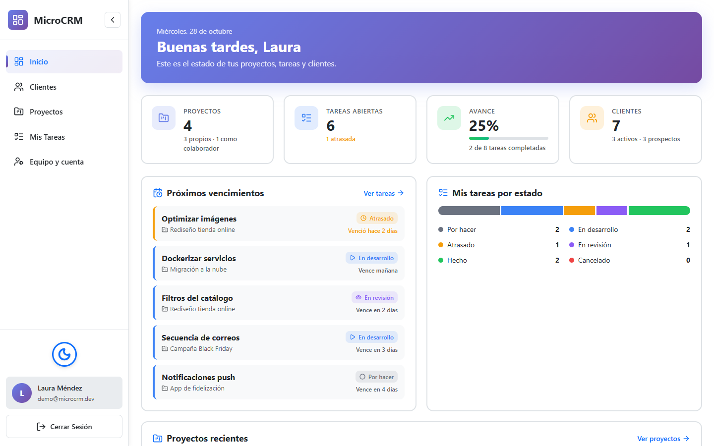

</div>

## Tabla de contenido

- [Qué es](#qué-es)
- [Características](#características)
- [Capturas](#capturas)
- [Inicio rápido con Docker](#inicio-rápido-con-docker)
- [Desarrollo local](#desarrollo-local)
- [Arquitectura](#arquitectura)
- [Modelo de datos](#modelo-de-datos)
- [Permisos](#permisos)
- [API](#api)
- [Variables de entorno](#variables-de-entorno)
- [Pruebas](#pruebas)
- [Roadmap](#roadmap)
- [Origen del proyecto](#origen-del-proyecto)
- [Licencia](#licencia)

## Qué es

Los equipos pequeños suelen llevar sus clientes en una hoja de cálculo, las tareas en un chat y el estado de cada proyecto en la cabeza de alguien. **MicroCRM** reúne esas tres cosas en una sola aplicación web:

- **Clientes**: una cartera con su embudo comercial (prospecto → activo → inactivo).
- **Proyectos colaborativos**: invitas a tu equipo y le asignas un rol por proyecto.
- **Tareas en Kanban**: se marcan como atrasadas automáticamente cuando vence su fecha.

Está pensado para freelancers, agencias y equipos de desarrollo de 2 a 15 personas.

## Características

| Módulo | Qué incluye |
|---|---|
| 🏠 **Dashboard** | Proyectos propios y como colaborador, tareas abiertas y atrasadas, % de avance, clientes por estado, próximos vencimientos y proyectos recientes |
| 👥 **Clientes** | CRUD completo, embudo prospecto / activo / inactivo, búsqueda, filtros, paginación, notas y exportación a CSV |
| 📁 **Proyectos** | Propios y compartidos, edición en línea, roles por proyecto (Administrador, Desarrollador, Revisor o personalizados) |
| 🗂️ **Kanban** | 5 columnas (Por hacer → En desarrollo → Atrasado → En revisión → Hecho) con **arrastrar y soltar** y acciones según el rol |
| ✅ **Mis Tareas** | Todas tus tareas de todos los proyectos, filtros por estado, botón para avanzar al siguiente paso y exportación a CSV |
| ⏰ **Automatización** | Un scheduler marca cada hora como *atrasadas* las tareas vencidas |
| 🔐 **Seguridad** | JWT, contraseñas con hash PBKDF2, reglas de fortaleza, límite de peticiones por IP y por usuario, permisos por proyecto |
| 🌗 **Tema claro y oscuro** | Se recuerda entre sesiones y no parpadea al cargar |
| 🐳 **Docker** | `docker compose up` levanta MySQL, la API y el frontend con datos de demo |

## Capturas

<table>
  <tr>
    <td width="50%">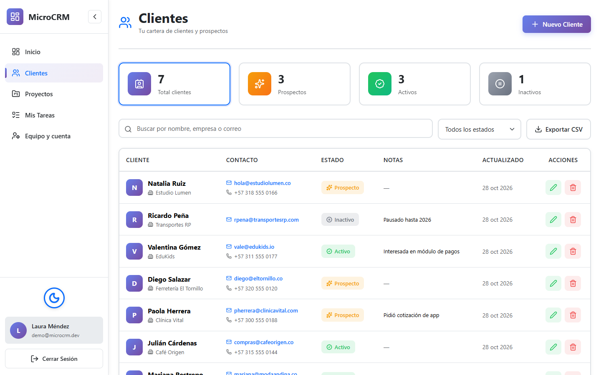<p align="center"><b>Clientes</b>: embudo, búsqueda y filtros</p></td>
    <td width="50%">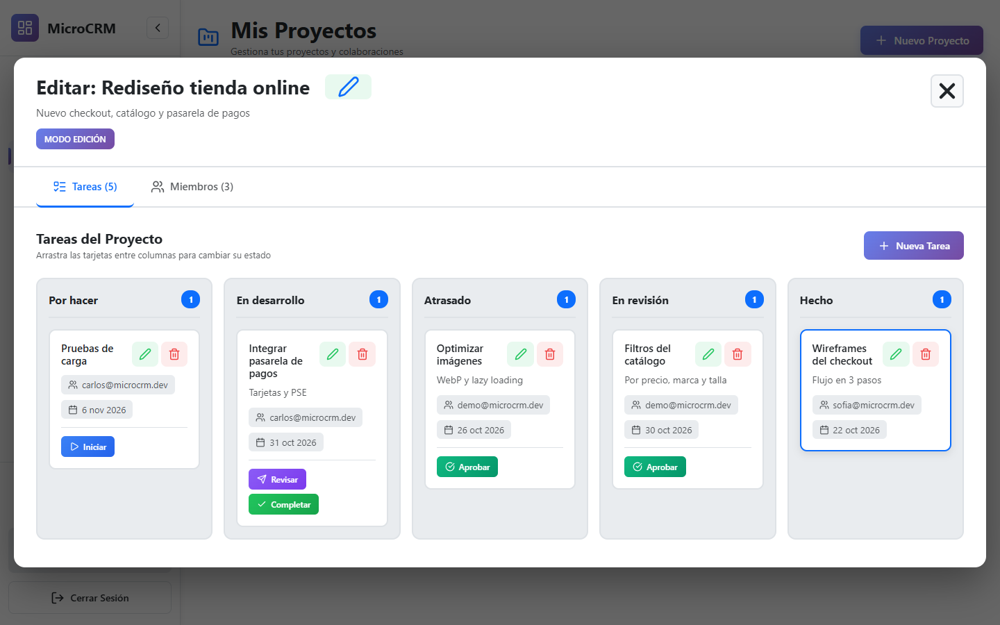<p align="center"><b>Kanban</b>: arrastra las tareas entre columnas</p></td>
  </tr>
  <tr>
    <td>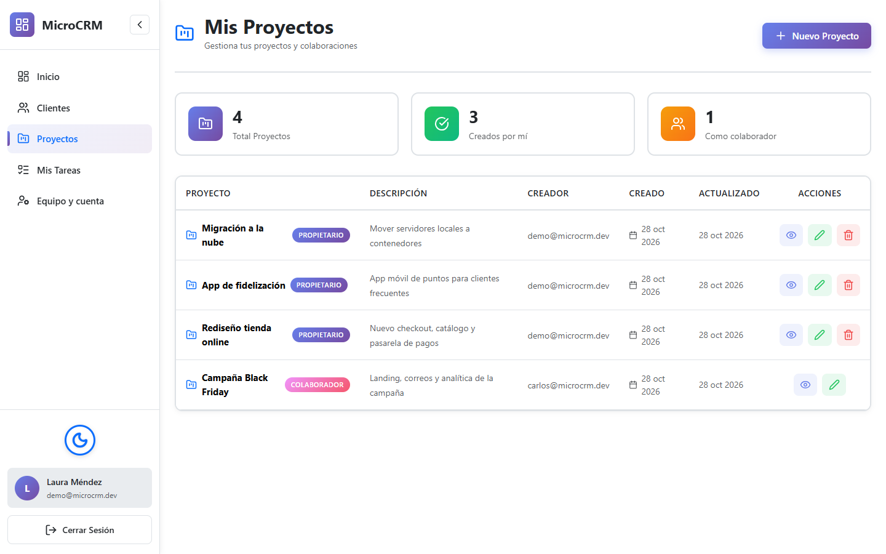<p align="center"><b>Proyectos</b>: propios y como colaborador</p></td>
    <td>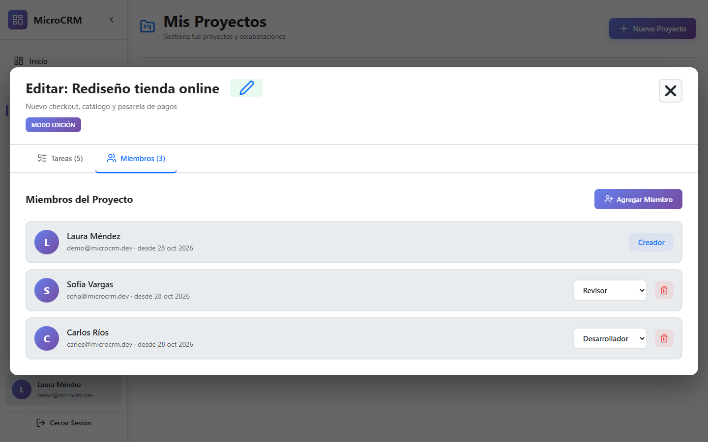<p align="center"><b>Miembros</b>: roles por proyecto</p></td>
  </tr>
  <tr>
    <td>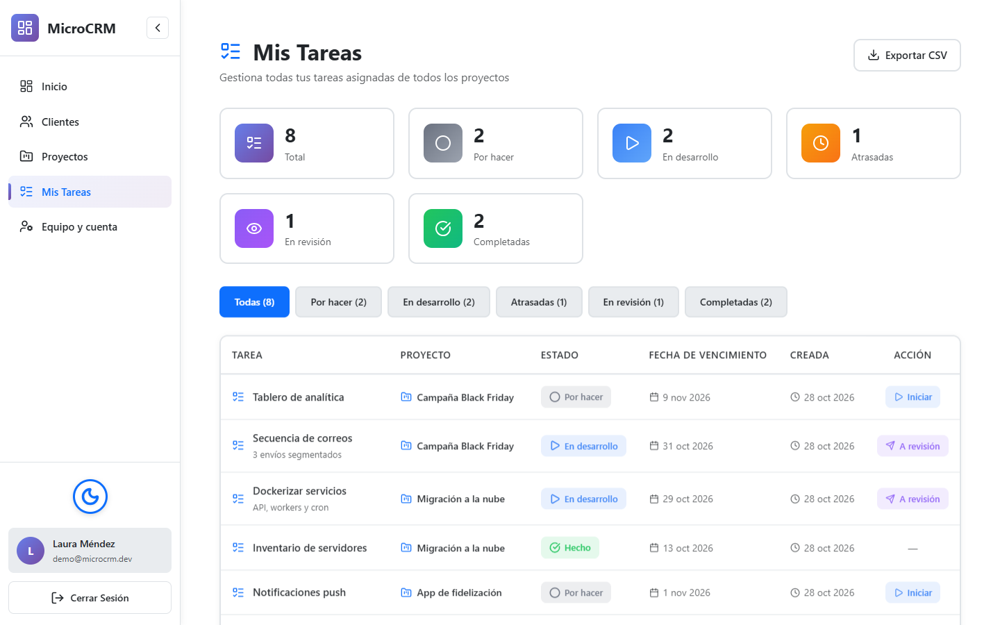<p align="center"><b>Mis Tareas</b>: vista personal con acciones rápidas</p></td>
    <td>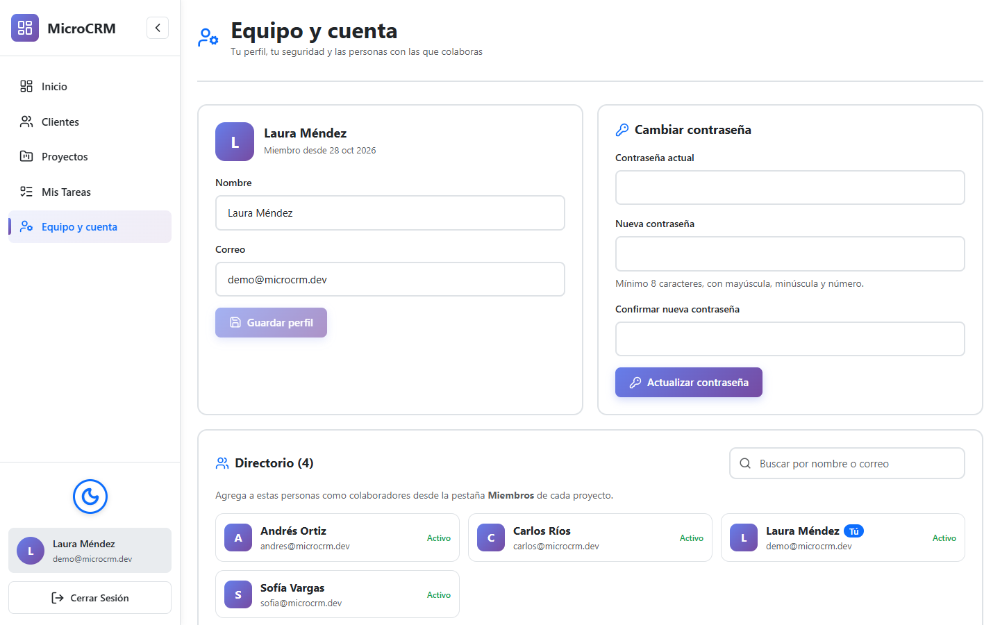<p align="center"><b>Equipo y cuenta</b>: perfil, contraseña y directorio</p></td>
  </tr>
  <tr>
    <td>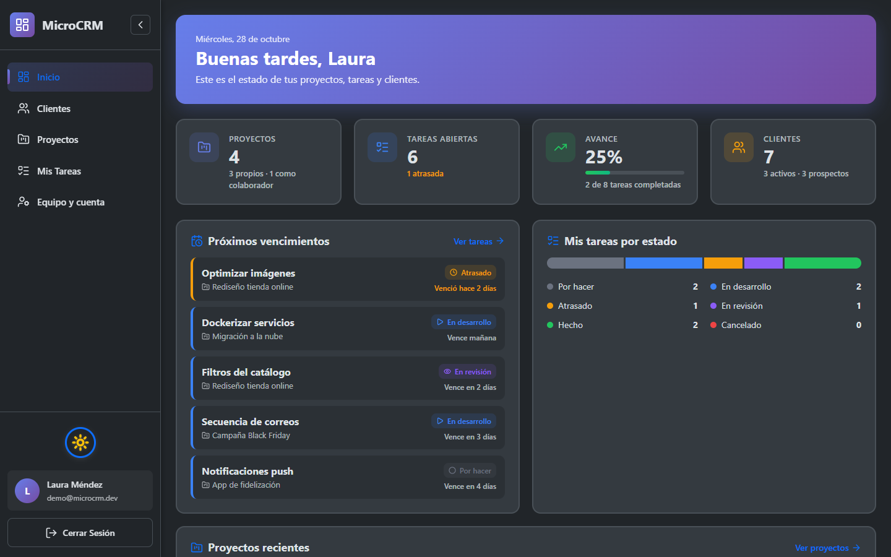<p align="center"><b>Tema oscuro</b></p></td>
    <td>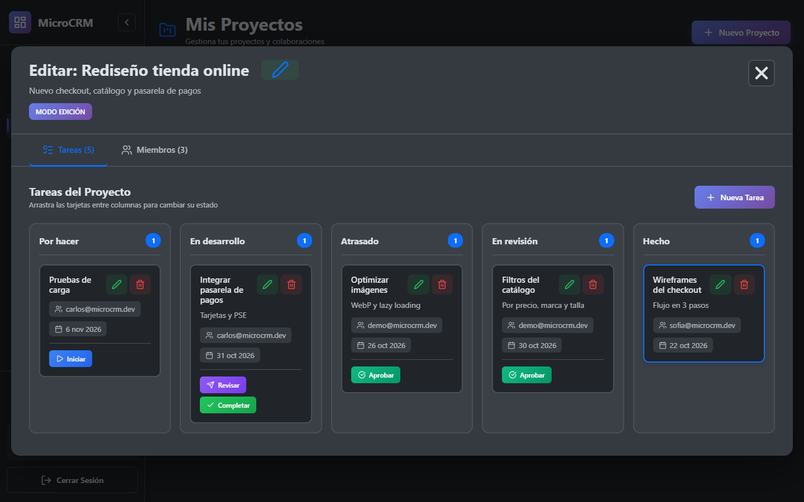<p align="center"><b>Kanban en tema oscuro</b></p></td>
  </tr>
  <tr>
    <td>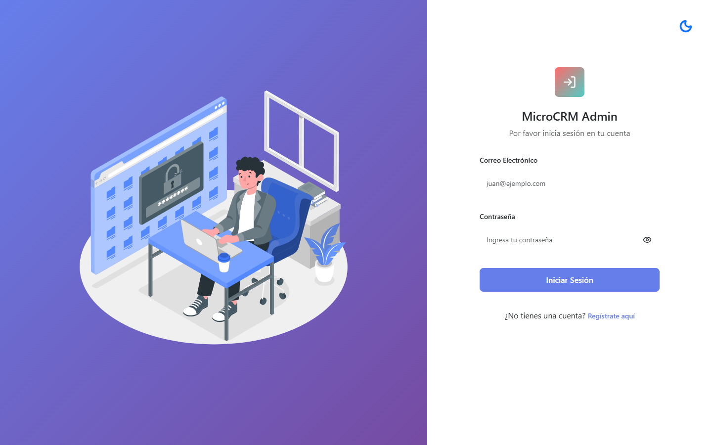<p align="center"><b>Inicio de sesión</b></p></td>
    <td>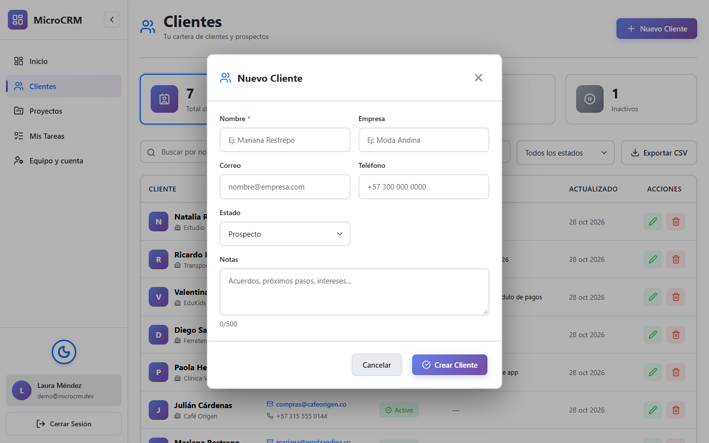<p align="center"><b>Crear y editar clientes</b></p></td>
  </tr>
</table>

<p align="center">
  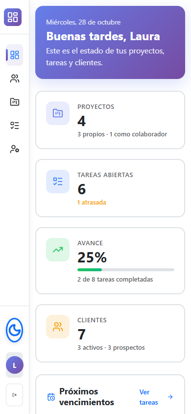<br />
  <b>Vista móvil</b>
</p>

## Inicio rápido con Docker

Requisitos: [Docker](https://docs.docker.com/get-docker/) con Compose.

```bash
git clone https://github.com/zemogc/MicroCRM.git
cd MicroCRM
docker compose up --build
```

| Servicio | URL |
|---|---|
| Aplicación web | http://localhost:5173 |
| API | http://localhost:8000 |
| Documentación interactiva (Swagger) | http://localhost:8000/api/docs |

Entra con el usuario de demo:

```
Correo:     demo@microcrm.dev
Contraseña: Demo1234
```

> Los datos de demo se cargan solos la primera vez (`SEED_DEMO_DATA=true`). Para empezar con la base vacía: `SEED_DEMO_DATA=false docker compose up --build`. Para borrar todo: `docker compose down -v`.

## Desarrollo local

### Backend (FastAPI)

Requisitos: Python 3.12 o superior. MySQL es opcional, porque para desarrollar basta con SQLite.

```bash
cd project/backend
python -m venv .venv
source .venv/bin/activate          # Windows: .venv\Scripts\activate
pip install -r requirements-dev.txt

cp .env.example .env
# Opción rápida sin MySQL: en .env pon DATABASE_URL=sqlite:///./microcrm.db

python -m app.seed                 # datos de demo (opcional)
uvicorn app.main:app --reload      # http://localhost:8000/api/docs
```

Las tablas se crean al iniciar la API. Si prefieres crearlas a mano en MySQL, usa [`microcrm_db_script.sql`](project/backend/microcrm_db_script.sql).

### Frontend (React + Vite)

Requisitos: Node.js 20.19 o superior.

```bash
cd project/micro-crm
cp .env.example .env               # VITE_API_URL=http://localhost:8000
npm install
npm run dev                        # http://localhost:5173
```

## Arquitectura

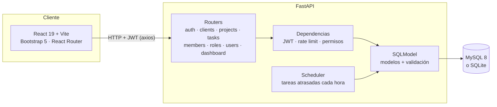

```
MicroCRM/
├── docker-compose.yml
├── docs/                     # Capturas y material académico
└── project/
    ├── backend/
    │   ├── app/
    │   │   ├── api/routes/   # Endpoints por recurso
    │   │   ├── core/         # Config, BD, JWT, permisos, rate limit, scheduler
    │   │   ├── models/       # Tablas y esquemas (SQLModel + Pydantic)
    │   │   ├── main.py       # App FastAPI
    │   │   └── seed.py       # Datos de demo
    │   ├── tests/            # pytest sobre SQLite
    │   └── Dockerfile
    └── micro-crm/
        ├── src/
        │   ├── components/   # Layout, Sidebar, StatusBadge...
        │   ├── context/      # Sesión y tema
        │   ├── modules/      # Inicio, Clientes, Proyectos, Tareas, Equipo, Auth
        │   └── services/     # Cliente axios con interceptores
        ├── nginx/            # Configuración para producción
        └── Dockerfile
```

## Modelo de datos

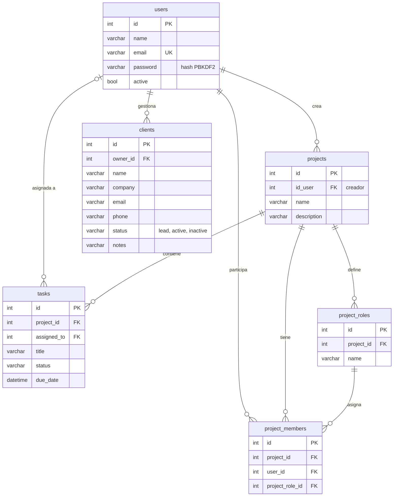

### Ciclo de vida de una tarea

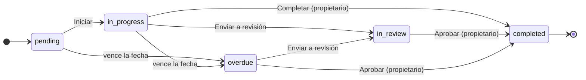

Solo las tareas en `pending` o `in_progress` pasan solas a `overdue`. Las que están en revisión no se tocan.

## Permisos

Cada proyecto tiene un **propietario** (quien lo creó) y **colaboradores** (miembros con un rol). La API aplica estas reglas en todos los endpoints:

| Acción | Propietario | Colaborador | Otro usuario |
|---|:---:|:---:|:---:|
| Ver el proyecto, sus tareas, miembros y roles | ✅ | ✅ | ❌ 404 |
| Editar o eliminar el proyecto | ✅ | ❌ 403 | ❌ 404 |
| Gestionar miembros y roles | ✅ | ❌ 403 | ❌ 404 |
| Crear, editar o eliminar tareas | ✅ | ❌ 403 | ❌ 404 |
| Cambiar el estado de una tarea | ✅ | Solo las suyas | ❌ 404 |

Además, cada usuario ve **solo su propia cartera de clientes**, y las tareas solo se pueden asignar a miembros del proyecto.

## API

Documentación interactiva en `/api/docs` (Swagger) y `/api/redoc`. Todos los endpoints, salvo registro y login, requieren `Authorization: Bearer <token>`.

| Recurso | Endpoints principales |
|---|---|
| Autenticación | `POST /api/auth/register` · `POST /api/auth/login` · `GET /api/auth/me` · `POST /api/auth/change-password` |
| Dashboard | `GET /api/dashboard/summary` |
| Clientes | `GET/POST /api/clients/` · `GET/PUT/DELETE /api/clients/{id}` |
| Proyectos | `GET/POST /api/projects/` · `GET/PUT/DELETE /api/projects/{id}` |
| Tareas | `GET/POST /api/tasks/` · `GET/PUT/DELETE /api/tasks/{id}` · `GET /api/tasks/project/{id}` · `GET /api/tasks/user/{id}` |
| Miembros | `POST /api/project-members/` · `GET /api/project-members/project/{id}` · `PUT/DELETE /api/project-members/{id}` |
| Roles | `POST /api/project-roles/` · `GET /api/project-roles/project/{id}` · `PUT/DELETE /api/project-roles/{id}` |
| Usuarios | `GET /api/users/` · `PUT/DELETE /api/users/{id}` (solo el propio) |

Los listados aceptan `skip`, `limit`, `order_by`, `order_dir` y `search`, y responden así:

```json
{ "items": [], "total": 42, "skip": 0, "limit": 10, "has_more": true }
```

Ejemplo:

```bash
TOKEN=$(curl -s -X POST localhost:8000/api/auth/login \
  -H "Content-Type: application/json" \
  -d '{"email":"demo@microcrm.dev","password":"Demo1234"}' | jq -r .access_token)

curl -s "localhost:8000/api/clients/?status=lead" -H "Authorization: Bearer $TOKEN" | jq
```

## Variables de entorno

**Backend** ([`project/backend/.env.example`](project/backend/.env.example))

| Variable | Por defecto | Descripción |
|---|---|---|
| `SECRET_KEY` | `devsecret` | Clave para firmar los JWT. **Cámbiala en producción.** |
| `ACCESS_TOKEN_EXPIRE_MINUTES` | `60` | Duración de la sesión |
| `DATABASE_URL` | — | URL de SQLAlchemy. Si se define, se ignoran las variables `MYSQL_*` (p. ej. `sqlite:///./microcrm.db`) |
| `MYSQL_HOST` / `MYSQL_PORT` | `localhost` / `3306` | Servidor MySQL |
| `MYSQL_USER` / `MYSQL_PASSWORD` | `root` / `root` | Credenciales |
| `MYSQL_DATABASE` | `microcrm_db` | Base de datos |
| `AUTO_CREATE_TABLES` | `true` | Crea las tablas que falten al iniciar |
| `ENABLE_SCHEDULER` | `true` | Marca las tareas atrasadas cada hora |
| `DB_ECHO` | `false` | Muestra el SQL en consola |
| `CORS_ORIGINS` | `http://localhost:5173` | Orígenes permitidos, separados por coma |
| `RATE_LIMIT_AUTH_PER_MIN` | `5` | Intentos de login o registro por minuto por IP |
| `RATE_LIMIT_API_PER_MIN` | `60` | Peticiones por minuto por usuario |

**Frontend** ([`project/micro-crm/.env.example`](project/micro-crm/.env.example))

| Variable | Por defecto | Descripción |
|---|---|---|
| `VITE_API_URL` | `http://localhost:8000` | URL base de la API |

## Pruebas

El backend tiene una suite de **pytest** que corre sobre SQLite, así que no necesita MySQL:

```bash
cd project/backend
pytest
```

Cubre autenticación y límites de peticiones, permisos por proyecto, miembros y roles, tareas (incluida la automatización de vencidas), clientes, el resumen del dashboard, paginación y borrado en cascada.

En el frontend:

```bash
cd project/micro-crm
npm run lint
npm run build
```

## Roadmap

- [x] Autenticación JWT con límites de peticiones
- [x] Proyectos colaborativos con roles por proyecto
- [x] Kanban de 5 estados con tareas atrasadas automáticas
- [x] Módulo de clientes con embudo comercial
- [x] Dashboard con indicadores
- [x] Docker Compose y datos de demo
- [x] Arrastrar y soltar tareas en el Kanban
- [x] Exportar clientes y tareas a CSV
- [ ] Vincular clientes con proyectos
- [ ] Notificaciones por correo de tareas por vencer
- [ ] Migraciones de base de datos con Alembic

## Origen del proyecto

MicroCRM nació como proyecto de la materia **Estructura de Datos y Algoritmos II** y desde entonces evolucionó a una aplicación completa. Los entregables originales y el diagrama inicial están en [`docs/academico`](docs/academico) y [`docs/img`](docs/img).

## Licencia

Distribuido bajo la licencia **MIT**. Consulta [LICENSE](LICENSE).

Hecho por **Zemog Gómez**.
